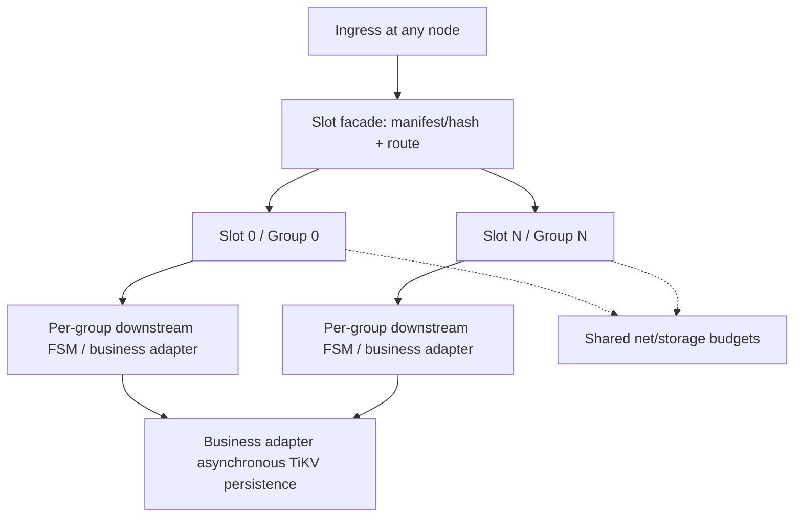

# Slot MultiRaft architecture feasibility

**中文：** [2026-10-16-slot-multiraft-feasibility.zh-CN.md](./2026-10-16-slot-multiraft-feasibility.zh-CN.md)

**Date:** 2026-10-16

**Status:** Foundation implementation authorized on 2026-10-16 and in progress; integration and acceptance results remain unverified. Historical assessment facts below retain their fixed source commits.

**Scope:** Whether the existing OpenRaft fork can support a generic Slot layer and how ech0 could integrate it.

## 1. Conclusion and evidence boundary

**Conditionally feasible.** Existing multi-group consensus, shared transport, and FSM interfaces are reusable. A Slot layer still needs stable mapping, a durable manifest, application routing, recovery readiness, and bounded lifecycle contracts.
The ech0 head CAS can leave this path only when an ordered `Admit` application command atomically performs the business checks and state changes within one group.
Renaming a Channel to a Slot, or adding Raft groups alone, does not remove that contention.

This assessment distinguishes **facts** at fixed commits, **recommendations** requiring implementation, **validation gates** requiring evidence, and **excluded capabilities** for the first version.
The original assessment inspected source, history, and documentation only. It ran no builds, experiments, performance tests, or compatibility tests and changed no dependencies.
The original assessment phases below record historical review order. The authorized foundation scope and current execution order are in the [foundation design](./2026-10-16-slot-multiraft-foundation.md) and [implementation plan](../plans/2026-10-16-slot-multiraft-foundation.md).

## Implementation decision update (2026-10-16)

The user confirmed shared understanding and authorized implementation: start from C, integrate necessary M improvements, and port R's RocksDB log while preserving C's ownership, exact-result, cancellation and recovery gates. Introduce a new Slot API and independent new data directories; retain old data and make no automatic API/WAL compatibility promise. Fix slot_count, hash version and a one-to-one Slot/Group mapping for the lifetime of a manifest. Online resharding is excluded.

The first delivery is a runnable three-process RF3, multiple-Slot foundation with a minimal test FSM, RocksDB consensus logs, FSM snapshots/restarts, leader changes, post-commit disconnect/Unknown, shutdown and resource bounds. Production Admit and TiKV integration come next. The existing local-node rollback behavior for startup/create/recovery proof failures is retained initially; proven isolation of Slot-local faults is a gate before production integration. Shared DB and manifest identity failures remain node faults. This does not assert that every runtime Raft fatal error shuts down the whole node.

| Layer | Confirmed responsibility |
| --- | --- |
| Slot | Stable partitioning, persisted manifest, server-validated routing, lifecycle and bounded resources |
| MultiRaft / OpenRaft | Consensus, native group driving and recovery gates |
| RocksDB | Local consensus log and metadata, not the entire business FSM database; FSM authority comes from log plus snapshot |
| Future Admit FSM | Atomic dedup, seq, accepted head, pending and fixed command result; flush and stop state |
| TiKV / delivery adapter | Long-term transactional message storage; async delivery and async TiKV persistence run as parallel paths after admission |

SENDACK means committed and applied admission, not a TiKV receipt or RECV confirmation. Full accepted-head/pending/result/flush migration and permanent dedup retention remain unchanged requirements. Historical suggestions and go/no-go language below do not reopen these confirmed foundation choices. Validation gates require evidence, not another approval of this authorized work.

## 2. Fixed versions and candidate baseline

| Label | Fixed commit | Purpose |
| --- | --- | --- |
| M | `44baed14b3717b6b6f5f7327790cc97299889e19` | main baseline of the original assessment branch |
| D | `ff52fc841b093d38e7961ed20e8b604ac186c626` | dev divergence reference |
| C | `28e668b676c803838eb64a04ba160fb10ad88316` | Current work; recommended integration candidate |
| R | `d6a5dbbb6d2f1c68e9e8bddbbfca18f562c1185c` | Dedicated RocksDB log branch |

Facts: C and R have merge-base D; neither contains the other. M and D have merge-base `f22bd846476e321ecad13fff0a986dd756999a5c`; D is not a descendant of M.
M has unique cluster descriptor/shared restart and Jepsen portability improvements (`f72b823`, `2a7e5b4`) that integration must review and preserve.
The `31e86b1` leadership control change is already in D and should not be reimplemented as a separate item.
Writing this document from M does not select M for implementation.

Recommendation: use C as the integration candidate and review each M-only general improvement for inclusion. Evaluate R's backend as a focused port rather than replacing C with the entire R branch.
C already has result delivery, runtime ownership, and asynchronous recovery validation gates; a direct replacement with R would lose behavior that must be retained.
Build and regression evidence for the selected baseline, and ownership of long-term upstream fork maintenance, remain unconfirmed. Acceptance must cover M-only startup/restart/Jepsen behavior individually; passing cargo checks alone is insufficient.

Facts: M pins registry `openraft` and `openraft-multi` to exactly `0.10.0-alpha.30`; the release package source commit is `19be0c27e5141d8acea3468cdb8a90875f117c27`.
C/D/R use `2nterdigital/openraft` at `ea46d0e571f7497f1f549e125254dfcb2ff45e2e`, still reporting alpha.30. Its direct parent is that upstream commit, and it adds an optional election observer.
ech0 declares `0.9.21` in Cargo but locks registry `0.9.25`.
Using OpenRaft in both projects does not establish API, wire, WAL, or snapshot compatibility. This assessment makes no such compatibility claim. If 0.9.25 and alpha.30 coexist, do not exchange native types directly; define an explicit version boundary.

## 3. Existing capabilities and gaps (facts)

Paths below refer to the indicated fixed commit and omit the common `crates/multiraft-` prefix. They do not imply that all capabilities are present in M.

| Version / source location | Existing behavior | Slot limitation |
| --- | --- | --- |
| M `fsm/src/lib.rs:6–24` | `GroupId=u64`; apply takes group/index/bytes and returns effects; snapshot/restore | No business partition or sequence contract |
| M `net/src/multiraft.rs:196–284` | Internal generic factory; public start/start_grpc limited to CounterFsm; empty group map on startup | Private generic startup is not a production extension API |
| M `net/src/node.rs:178–199` | Public low-level generic node | MemLog only; does not establish generic durable startup |
| M `net/src/multiraft.rs:324,340,847` | Explicit create/ensure group | Caller must reconstruct groups from a manifest; no automatic scan of all group directories |
| M `net/src/multiraft.rs:856,933` | Local client_write; NotLeader hint | No built-in application forwarding |
| M `net/src/grpc/server.rs:80`, `grpc/router.rs:55,105,161` | Raft RPC; channel cache by NodeId, group demultiplexing | Not a business-slot router; no guarantee of exactly one physical connection at all times |
| M `net/src/multiraft.rs:919,935`, `core/src/error.rs:26` | ProposeOk contains index/term only | Internal effects from `store/src/sm_bridge.rs:400,418` are lost at the old facade |
| M `net/src/multiraft.rs:868,888` | Repeated same-group writes in propose_batch | No cross-group transaction; early failure does not mean other writes did not commit |
| M `net/src/multiraft.rs:950,964,1083` | ReadIndex and stale watermark | Read semantics must be explicit |
| M `net/src/multiraft.rs:983,992` | Best-effort leader notification | Not a write fence |
| C `net/src/fsm_factory.rs:9,40` | Public StateMachineFactory with node/group context | Reusable entry point for a generic Slot FSM |
| C `net/src/runtime.rs:143,149`, `runtime/requests.rs:160–217` | Unique strong owner, weak handle; exact committed/applied entry effects; absolute deadline and Unknown | Still needs business command results and Slot lifecycle semantics |
| C `net/src/application_rpc/operation.rs:36,83,148` | NotDispatched → MayHaveDispatched → Tonic dispatch; one attempt, no automatic retry | Application RPC and Raft have different purposes/addresses; do not claim one physical connection |
| C `net/src/grpc/router.rs:74` | Generation pool | Not placement management |
| C `net/src/multiraft/read.rs:17` | Independent ReadIndex per call; former shared round removed | Performance assumptions must not rely on the old shared round |
| C `net/src/multiraft/membership.rs:104`, `runtime/control.rs:43` | Membership facade; control prechecks once and triggers at most once | Membership is not weak-owned membership management; control is not an automatic retry engine |

M still creates a Raft instance per group (`net/src/multiraft.rs:1251,1276`), with tasks, heartbeats, memory, and WAL costs.
FSM locking occurs in `store/src/sm_bridge.rs:85,381`; snapshot freeze constructs a Vec under lock (`:215,226`) before entering the blocking catalog.
A fixed group count does not remove these costs or guarantee that hot groups cannot delay cold groups.

C's asynchronous validation is not an optional optimization to discard: `fsm/src/lib.rs:57,62` supports opt-in, short-lock capture, and proof outside the lock; `store/src/sm_bridge/validation.rs:118` handles budget, cancellation, and panic.
`store/src/sm_bridge/native/install.rs:115,135` activates only after proof and the readiness hook complete.
`net/src/grpc/server.rs:147` nonfatally rejects pending-startup snapshots before core dispatch.
`runtime/startup/admission.rs:38,79,82` and `runtime/recovery.rs:55,71,81` constrain retained batches, exclusivity/empty owners, and readiness after recovery validation.
Integration must preserve these gates. A focused R port must also validate preservation of C validation combined with cancellation/shutdown.

## 4. Slot vocabulary and responsibility (recommendations)

| Concept | Contract |
| --- | --- |
| businessPartitionKey | Opaque canonical bytes provided downstream; the generic library does not parse Channel/User |
| SlotId | Stable logical partition identity |
| GroupId | Replication group identity; one-to-one with SlotId initially |
| NodeId | Host/node identity |
| leader | Mutable consensus role, not a permanent owner |
| manifest | Durable cluster identity, slot_count, hash_version, encoding, seed, Slot↔Group mapping, and replicas |

In C `net/src/runtime.rs:34,46,166`, voters are bootstrap inputs rather than current membership authority; the default max_inflight of 1024 is a node-wide permit limit, and RuntimeShared.slots is semaphore capacity, not partition Slots.
C `net/src/runtime/startup.rs:16,85` treats input_digest as opaque, unverified by the library or cohort; configuration_verified is always false. Existing group registration does not prove Slot configuration agreement.
All nodes must validate the manifest at startup. Cross-node agreement and server-side validation are new requirements; configuration or disk identity mismatches must fail closed.
Reserve GroupId/domain space to avoid metadata group collisions. Do not use `std::DefaultHasher` or arbitrarily change N before taking a modulus.
Determine slot_count through resource and workload measurements; this document recommends neither 256 nor copying Wukong defaults.

The diagram is a proposed module dependency structure, not an existing implementation. Arrows denote dependencies, not an execution sequence placing WAL after apply. Shared resource limits cover all groups; asynchronous TiKV persistence belongs to the business adapter.



Recommended boundaries:

- A thin Slot module or separate crate owns the manifest, stable mapping, application routing, group lifecycle, leader hints, single-attempt bounded forwarding, and read/fence contracts.
- MultiRaft owns consensus, membership, Raft networking, WAL, FSM driving, and native recovery gates.
- The ech0 adapter owns eligibility, Admit, consecutive seq, exact command results, pending, flush, and stop.

Keep business rules out of generic net/cache code. Any node may accept ingress, but only ordered apply in the destination group decides the business result.
A Raft index is a replication position, not a Channel business seq.

## 5. Proposal and query contracts (proposed, not existing APIs)

The sketch describes semantics that still require review:

```text
Proposal(slot, command_id, command_bytes, absolute_deadline)
  -> Applied(command_result) | NotDispatched(reason) | Unknown(phase)
Query(slot, query_bytes, consistency, absolute_deadline)
  -> QueryResult | NotReady | Unavailable(reason)
```

M propose exposes index/term only. C's ProposeApplied can return exact entry effects, but the Slot API and business result model above are unimplemented.
A linearizable Query must complete native ReadIndex for the destination group and satisfy apply visibility; a stale query explicitly returns its watermark.
Leader status is a routing hint. Native submission and read contracts provide safety.
A pure read failure does not produce a write Unknown. When querying the result of a previous Unknown write, a miss or failed query does not prove that the original write did not commit or cannot apply later.

Example application command: `Admit(channel, sender, command_id, intent, payload, message_id, deterministic_inputs)`.
Within one deterministic apply, check dedup first and return the fixed result. For a new admission, atomically check stop, capacity, and eligibility inputs; allocate consecutive seq and update accepted head, pending, and command result.
Fixed-result priority is a business FSM rule; generic runtime/node admission may still reject overload or unavailability, so unconditional result replay is not reachable through every layer.
Do not increment seq and write the command separately. Requests known not to have entered the log and infrastructure rejections are not durable command results.
Whether to record business rejections must follow the existing ech0 contract, which currently fixes successful results. This proposal does not automatically make every rejection permanently idempotent.
Capacity decisions use deterministic logical counts in replicated state and identical limits within the group, not instantaneous heap usage.
Randomness, clocks, or external I/O must not decide divergent replica results inside apply. Fix and validate message_id, business time, eligibility snapshots, and other required inputs before proposal.

Read external eligibility at business ingress, before constructing the proposal, retaining the explicitly accepted short stale window. Deterministic apply checks only replicated deterministic inputs and does not access TiKV or external services.
A group version across stores is not a strict revocation fence; stricter revocation requires a separately reviewed colocation or version-credential protocol.
The original batch contains command/head/pending/flush only; do not assume it already includes permission conditions.
A new Channel may initialize from a fenced persisted head only after proving that no existing accepted/pending state exists.
Recovery or migration of an existing Channel must import consistent accepted head, pending, results, flush, and corresponding persisted progress. A lagging TiKV head must not replace accepted head and roll sequence allocation backward.
A single TiKV head read cannot enable cutover: fence old admissions and the collector, drain old work, and migrate pending/result/head/flush completely.
This is a design gate before ech0 integration begins.

Never automatically repropose Unknown. A caller may later explicitly retry the same command_id; the FSM must deduplicate it and return the original result.
Current command results are retained permanently; do not add TTL/GC without separate approval. Full capacity may reject new commands, but existing result replay takes priority inside business apply. Storing only the highest seq is insufficient.
Effects are responses, not additional durable facts. After losing a response, query the replicated result using the same command_id.

## 6. Routing, lifecycle, and resource limits (recommendations)

Start with a fixed manifest, static replicas, and a fixed Slot↔Group mapping. Serve a group only after recovery completes and it becomes ready.
Changing group membership changes the group's replicas; remapping a Slot is a different operation.
Online resharding, split/merge, and cross-group transactions are excluded from the first version.
A route epoch alone does not prove safe migration. Future work requires an old-write fence/quiescence, copy validation, cutover, and interrupted-migration recovery protocol.

Bound both request counts and bytes per Slot and per node. Keep the caller's local absolute deadline; forward remaining budget across machines using the existing byte RPC budget mechanism. Do not transmit a local Instant or reset the budget.
Single-attempt forwarding must distinguish rejection before dispatch from Unknown after dispatch; stale hints must not cause unlimited forwarding.
Durable owners must retain accepted work after caller cancellation.
Validate hot/cold Slot fairness across shared networking, WAL, and snapshot resources; do not require one resident task per Channel.
Shutdown stops intake/forwarding, drains accepted owned work, and then establishes snapshot/log shutdown evidence.
Report unfinished work as Unknown or residual work. Waiter completion alone does not establish a clean shutdown.

## 7. Storage and recovery choices (facts and recommendations)

R's `store/src/log_rocks.rs:23,28,99` uses a node-owned database with `g + big-endian GroupId` namespaces and synchronous WriteBatch writes.
The blocking closure owns the callback in `storage.rs:158,284,335`, notifying only after successful writes; cancelling a waiter does not lose the callback.
A shared database does not establish cross-group scheduling fairness, atomic FSM updates across groups, or TiKV transactions. Cross-group group commit and throughput gains remain unproven.

M FileLog defaults to `Os`, reaching page cache only; `Data/All` sync (`core/src/config.rs:104,160`, `store/src/log_file.rs:185`). Its group commit is limited to one group owner.
Rocks writes always synchronize WAL; Os/Data synchronize WAL and All uses fsync.
The same flag across backends does not imply the same power-loss durability. Compare actual synchronization behavior.
R `net/src/multiraft/recovery.rs:169,190,197,220` provides no automatic FileLog-to-Rocks conversion, rejects returning to FileLog after the marker, and refuses to recreate a missing DB.
R snapshots remain file-backed Vec/provider snapshots (`docs/rocksdb-raft-log.md:70,91`), not a business FSM database.

Validate three durability layers separately: consensus log; FSM checkpoint and applied position; TiKV receipt.
Applied does not mean committed to TiKV.
A new Slot snapshot must include command results, seq/head, pending/flush/stop, and the recovery basis. Purge requires recoverability evidence.
For migration, use a separate new data directory and controlled import after a full format/semantic review. Do not directly reuse ech0's 0.9 logs or claim supported migration.

## 8. ech0 integration and alternative paths (recommendations)

SEND command/head/pending/flush must share the same ChannelKey Slot.
Presence user/device state may use UserId and retain the existing generic cache. It need not be forced into the message Slot or require replacing every ADR.
The collector currently claims atomically across Channels (ech0 collector `:563,605,616,627`); this cannot transparently become an atomic cross-Slot operation.
For the first version, group batches within a Slot while preserving cross-Channel TiKV atomic transactions and existing Unknown claim and stop/resume semantics.
Preserve exact holder/revision, Unknown, and fail-stop contracts. Do not interpret every failure as NothingApplied.
If cross-Slot claims are required, review partial claims and fencing separately rather than weakening failure contracts.

| Path | Reuse | Cost requiring evidence |
| --- | --- | --- |
| Extend ech0's existing raftd | Existing application contracts, version, and operations integration | Multiple groups, shared transport, group recovery, and Slot lifecycle |
| Reuse this fork | Multi-group consensus, shared transport, HA, C's owner/result/recovery gates | Alpha version transition, baseline integration, application adaptation, long-term fork maintenance |

An existing project does not establish that reuse costs less. Decide after single-Slot correctness and comparable measurements.

## 9. Phased acceptance gates (validation required)

| Phase | Reviewable deliverable | Exit condition |
| --- | --- | --- |
| 0 Baseline | C/M inventory, integration selection, OpenRaft pin and compatibility risks, first-version Rocks decision | Preserve M-only general improvements and C gates; obtain regression evidence for the chosen baseline |
| 1 Slot contract | Manifest/hash tests, router/start/read, result-bearing test FSM | Stable restart mapping; mismatches fail closed; no ingress before ready; results match the exact applied entry |
| 2 Single-Slot Admit | Deterministic ech0 FSM, dedup/result retention, fenced initialization design | Cancellation/Unknown cannot duplicate seq; cold state and stop fail closed; TiKV baseline cannot roll head backward |
| 3 RF3 durable recovery | Durable log, snapshot/purge, corruption and leader-change fault evidence | Preserve proof/readiness gates; recover acknowledged results; missing evidence cannot yield ready |
| 4 Multiple Slots and B4 | Hot/cold fairness, resource bounds, baseline/candidate reports with identical instrumentation | At least two alternating comparisons; identical load and durability; separate success/failure statistics and suitable histogram resolution |
| 5 Optional follow-up | Independent migration or dynamic placement design | Separate approval of format, old-write fencing, validation/cutover/recovery |

Phase 4 must not alter the 64 round-robin load generator to hide unissued requests. Report offered, issued, completed, failed, and unissued counts.
First verify that all planned 60000 requests are issued and succeed or reach an explicit terminal outcome agreed before the experiment, without unexpected rejections or unissued requests, and pass the correctness oracle. Only then compare successful-request P99.
Freeze numerical thresholds, denominators, and terminal-outcome contracts before experiments; this document claims no achieved target.
Do not assume more Slots improve a single hot key. Measure latency, resources, and recovery cost as well as aggregate TPS.

Historical records are not validation from this round: C `docs/specs/async-recovery-validation-evidence.md:3,7,13` records final measurements at `95c6e6c`, 366 passed, 12 ignored, and one `acceptance.sh` run using three actual OS processes. Dedicated G1 ENOSPC/RF3 was not run.
R `docs/rocksdb-raft-log.md:105,118` records its specific validation commands, not certification of the entire workspace.
Do not report those numbers as successful tests of the eventual integration baseline.

## 10. Historical assessment risks and go/no-go (see decision update)

| Risk / open decision | Answer required before implementation |
| --- | --- |
| Divergent baselines and alpha dependencies | Which M/C changes survive; who owns the upstream fork and version regression work |
| Rocks in the first version | Durability target, migration restrictions, and preservation of C gates |
| slot_count/hash/replicas | Canonical encoding, stable parameters, and measured resource budget |
| Eligibility and result retention | Accepted stale window, revocation requirements, permanent-result capacity budget; separate review for any expiry change |
| Cross-Slot requirements | Whether same-Slot transactions suffice; how collector cross-Channel TiKV transactions survive |
| Global semantics | Whether strict global capacity/global snapshots remain required; if so, a separate coordination protocol |
| Data migration | Import basis, fencing, validation, rollback, and separate data directory design |

**Conditional go:** If fixed initial mapping and same-Slot atomicity are accepted, ordered Admit and fenced initialization are specified, recovery gates remain intact, and each phase obtains evidence, the work may enter a separate implementation review for a single-Slot prototype.
**No-go:** The current proposal does not satisfy removing CAS by grouping alone, direct 0.9 data compatibility, transparent cross-Slot transactions, or bypassing proof/readiness gates.
At the original assessment stage, no prototype, deployment or migration was approved. Foundation implementation is now authorized as recorded above; production integration and migration remain outside this delivery.

## 11. Fixed source references

Repository context: [architecture](../ARCHITECTURE.md), [original multi-group design](./2026-07-18-multiraft-design.md), [upstream pin](../upstream.md).
The summaries above support self-contained review; fixed links below allow source verification.
ech0 references are fixed at `c12a75b19e5718e86ac96ec2c9d12b59c611b55c`:

- [ech0: dependency versions in Cargo.lock](https://github.com/2nterdigital/ech0-1delivery/blob/c12a75b19e5718e86ac96ec2c9d12b59c611b55c/Cargo.lock).
- [ech0: collector cross-Channel claims](https://github.com/2nterdigital/ech0-1delivery/blob/c12a75b19e5718e86ac96ec2c9d12b59c611b55c/crates/business/src/send/persist/collector.rs#L563).

- [M: multi-group facade and startup](https://github.com/2nterdigital/multiraft/blob/44baed14b3717b6b6f5f7327790cc97299889e19/crates/multiraft-net/src/multiraft.rs#L196).
- [M: FSM bridge and snapshots](https://github.com/2nterdigital/multiraft/blob/44baed14b3717b6b6f5f7327790cc97299889e19/crates/multiraft-store/src/sm_bridge.rs#L215).
- [C: exact applied results and deadlines](https://github.com/2nterdigital/multiraft/blob/28e668b676c803838eb64a04ba160fb10ad88316/crates/multiraft-net/src/runtime/requests.rs#L160).
- [C: application RPC dispatch states](https://github.com/2nterdigital/multiraft/blob/28e668b676c803838eb64a04ba160fb10ad88316/crates/multiraft-net/src/application_rpc/operation.rs#L36).
- [C: historical recovery validation evidence](https://github.com/2nterdigital/multiraft/blob/28e668b676c803838eb64a04ba160fb10ad88316/docs/specs/async-recovery-validation-evidence.md).
- [R: log and backend restrictions](https://github.com/2nterdigital/multiraft/blob/d6a5dbbb6d2f1c68e9e8bddbbfca18f562c1185c/docs/rocksdb-raft-log.md).
- [Exact OpenRaft fork commit](https://github.com/2nterdigital/openraft/commit/ea46d0e571f7497f1f549e125254dfcb2ff45e2e).
- [Exact upstream FSM API](https://github.com/databendlabs/openraft/blob/19be0c27e5141d8acea3468cdb8a90875f117c27/openraft/src/storage/v2/raft_state_machine.rs), [Raft API](https://github.com/databendlabs/openraft/blob/19be0c27e5141d8acea3468cdb8a90875f117c27/openraft/src/raft/mod.rs), [membership](https://github.com/databendlabs/openraft/blob/19be0c27e5141d8acea3468cdb8a90875f117c27/openraft/src/raft/impl_raft_blocking_write.rs).
- [Upstream openraft-multi networking](https://github.com/databendlabs/openraft/blob/19be0c27e5141d8acea3468cdb8a90875f117c27/multiraft/src/network.rs): GroupRouter/Adapter/Factory are not a placement system.
