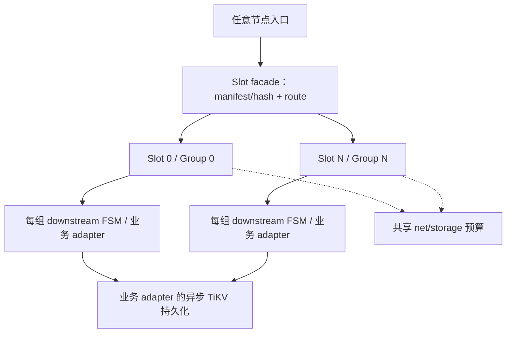

# Slot MultiRaft 架构可行性评估

**English:** [2026-10-16-slot-multiraft-feasibility.md](./2026-10-16-slot-multiraft-feasibility.md)

**日期：** 2026-10-16

**状态：** 76ce0dd 首验证版完成：最终 workspace 和本机 RF3/legacy 验收通过；生产接入及历史未定位 observer 风险仍为后续门槛。下文历史评估事实继续绑定原固定源码；当前 API 和检查见[底座设计](./2026-10-16-slot-multiraft-foundation.zh-CN.md)与[证据](../evidence/2026-10-16-slot-foundation.zh-CN.md)。

**范围：** 基于 OpenRaft 的现有 fork 能否承载通用 Slot 层，以及 ech0 如何接入。

## 1. 结论与证据边界

**有条件可行。** 现有多组共识、共享传输和 FSM 接口可以复用；Slot 层仍需稳定映射、持久 manifest、业务路由、恢复就绪与有界生命周期契约。
ech0 的 head CAS 只有在 `Admit` 作为同组有序应用命令，原子完成业务检查和状态变更后才能从该路径移除。
把 Channel 改名为 Slot，或只增加 Raft Group，都不能消除该竞争。

本文区分四类内容：**事实**是固定提交中的行为；**建议**是待实现设计；**待验证**是准入门槛；**未采用**是首期排除的能力。
原评估阶段只做源码、历史和文档检查，没有运行构建、实验、性能测试或兼容测试；没有修改依赖。
后文原评估阶段保留历史评审顺序；已授权底座范围和当前执行顺序见[底座设计](./2026-10-16-slot-multiraft-foundation.zh-CN.md)与[实施计划](../plans/2026-10-16-slot-multiraft-foundation.zh-CN.md)。

## 实施决策更新（2026-10-16）

用户已确认共同理解并授权实施：从 C 出发，吸收 M 的必要改进，专项移植 R 的 RocksDB 日志，保留 C 的 owner、精确结果、取消与恢复门禁。采用新 Slot API 和独立新 data 目录；旧数据保留，不承诺 API/WAL 自动兼容。manifest 生命周期内固定 slot_count、hash version 和 Slot/Group 一对一映射，不做在线 reshard。

首阶段交付可运行的三进程 RF3 多 Slot 底座：最小测试 FSM、RocksDB 共识日志、FSM 快照/重启、切主、提交后断连/Unknown、关闭和资源限额。生产 Admit/TiKV 下一阶段接入。startup/create/recovery proof 失败先继承现有整 local node rollback；可证明 Slot 局部故障隔离是生产接入前门槛。共享 DB 和 manifest 身份错配仍是 node 故障；这不表示所有 runtime Raft fatal 都会关闭整 node。

| 层 | 已确认职责 |
| --- | --- |
| Slot | 稳定分区、持久 manifest、服务端校验路由、生命周期和有界资源 |
| MultiRaft / OpenRaft | 共识、原生组驱动与恢复门禁 |
| RocksDB | 本地共识日志和 metadata，并非全部业务 FSM 库；FSM 权威由 log + snapshot 恢复 |
| 未来 Admit FSM | 原子 dedup、seq、accepted head、pending 和固定 command result，以及 flush/stop 状态 |
| TiKV / delivery adapter | 长期消息事务 storage；异步投递和异步 TiKV 持久化是接纳后并行路径 |

SENDACK 表示接纳已 committed + applied，不是 TiKV 回执或 RECV 确认。全量 accepted head/pending/result/flush 迁移及永久 dedup 保留要求不变。下文历史建议及 go/no-go 不重新打开已确认底座选择；文档门槛要求验证证据，不要求再次批准本轮已授权工作。

## 2. 固定版本与候选基线

| 标识 | 固定提交 | 用途 |
| --- | --- | --- |
| M | `44baed14b3717b6b6f5f7327790cc97299889e19` | 原评估文档分支的 main 基线 |
| D | `ff52fc841b093d38e7961ed20e8b604ac186c626` | dev 分叉参照 |
| C | `28e668b676c803838eb64a04ba160fb10ad88316` | 当前工作成果，建议作为整合候选 |
| R | `d6a5dbbb6d2f1c68e9e8bddbbfca18f562c1185c` | RocksDB 日志专项分支 |

事实：C 与 R 的 merge-base 为 D，互不包含；M 与 D 的 merge-base 为 `f22bd846476e321ecad13fff0a986dd756999a5c`，D 不是 M 后代。
M 独有 cluster descriptor/shared restart 和 Jepsen portability 改进（`f72b823`、`2a7e5b4`），后续整合必须审查保留。
`31e86b1` leadership control 已在 D 中，不应重新立项实现。
从 M 写文档不等于决定从 M 实施。

建议：以 C 为候选，逐项吸收 M 独有的通用改进；R 的存储后端按专项移植评估，暂不整支替换 C。
C 已包含结果返回、运行时所有权与异步恢复校验门禁，直接换成 R 会丢失需要保留的行为。
候选基线的构建、回归、上游 fork 长期维护责任尚未确认。验收须逐项覆盖 M-only startup/restart/Jepsen 行为，不能以 cargo 通过代替。

事实：M 的 `openraft` 和 `openraft-multi` 精确锁定 registry `0.10.0-alpha.30`，发布包源码提交为 `19be0c27e5141d8acea3468cdb8a90875f117c27`。
C/D/R 使用 `2nterdigital/openraft` 的 `ea46d0e571f7497f1f549e125254dfcb2ff45e2e`，版本号仍是 alpha.30；该提交直接继承上述上游提交并增加可选 election observer。
ech0 的 Cargo 声明 `0.9.21`，lock 实际为 registry `0.9.25`。
同用 OpenRaft 不证明 API、wire、WAL 或 snapshot 兼容；本轮不作这种兼容承诺。若 0.9.25 与 alpha.30 并存，禁止直接互传原生类型，须有明确版本边界。

## 3. 现有能力与缺口（事实）

以下路径均以对应标识的固定提交为准，省略公共前缀 `crates/multiraft-`；不是声称这些能力都已进入 M。

| 版本 / 源码位置 | 已有行为 | 对 Slot 的限制 |
| --- | --- | --- |
| M `fsm/src/lib.rs:6–24` | `GroupId=u64`；apply 接受 group/index/bytes，返回 effects；支持 snapshot/restore | 没有业务分区与序号契约 |
| M `net/src/multiraft.rs:196–284` | 内部泛型 factory；公开 start/start_grpc 仅 CounterFsm；启动 group map 为空 | 私有泛型启动不能当成生产扩展 API |
| M `net/src/node.rs:178–199` | 公开底层泛型节点 | 仅 MemLog，不能据此声称通用持久启动 |
| M `net/src/multiraft.rs:324,340,847` | 显式 create/ensure group | 调用方须从 manifest 重建组；不会自动扫描全部组目录 |
| M `net/src/multiraft.rs:856,933` | propose 调本机 client_write；NotLeader 提供 hint | 没有内置业务转发 |
| M `net/src/grpc/server.rs:80`、`grpc/router.rs:55,105,161` | Raft RPC；按 NodeId 缓存 channel 并按 group demux | 不是 business-slot router，也不证明始终只有一个物理连接 |
| M `net/src/multiraft.rs:919,935`、`core/src/error.rs:26` | ProposeOk 只有 index/term | `store/src/sm_bridge.rs:400,418` 的内部 effects 在旧外观中丢失 |
| M `net/src/multiraft.rs:868,888` | 同组多次 propose_batch | 不是跨组事务；中途失败不代表其他写入未提交 |
| M `net/src/multiraft.rs:950,964,1083` | ReadIndex 与 stale watermark | 两种读语义必须显式区分 |
| M `net/src/multiraft.rs:983,992` | best-effort leader 状态通知 | 不能作为写 fence |
| C `net/src/fsm_factory.rs:9,40` | 公开 StateMachineFactory，含 node/group 上下文 | 可作为通用 Slot FSM 接入点 |
| C `net/src/runtime.rs:143,149`、`runtime/requests.rs:160–217` | 唯一强 owner、弱 handle；propose 返回精确提交并应用项的 effects；绝对 deadline、Unknown | 还需业务命令结果与 Slot 生命周期契约 |
| C `net/src/application_rpc/operation.rs:36,83,148` | NotDispatched → MayHaveDispatched → Tonic dispatch；单 attempt，无自动重试 | 应用 RPC 与 Raft 使用不同 purpose/address，不应宣称单一物理连接 |
| C `net/src/grpc/router.rs:74` | generation pool | 不是 placement 管理 |
| C `net/src/multiraft/read.rs:17` | 每次调用独立 ReadIndex，原 shared round 已撤销 | 不可按旧共享读轮次估算性能 |
| C `net/src/multiraft/membership.rs:104`、`runtime/control.rs:43` | membership 外观；控制请求一次 precheck、至多一次 trigger | membership 不等于具弱所有权的成员管理；控制不是自动重试器 |

M 每组仍建立 Raft 实例（`net/src/multiraft.rs:1251,1276`），有 tasks、心跳、内存与 WAL 成本。
FSM 锁在 `store/src/sm_bridge.rs:85,381`；快照 freeze 在锁内构造 Vec（`:215,226`），之后才进入 blocking catalog。
固定组数不能消除这些开销，也不能保证热点不会阻塞冷组。

C 的异步校验不是可省略的优化：`fsm/src/lib.rs:57,62` 允许 opt-in、短锁 capture、锁外 proof；`store/src/sm_bridge/validation.rs:118` 处理预算、取消和 panic。
`store/src/sm_bridge/native/install.rs:115,135` 在 proof 与 readiness hook 完成后才 activate。
`net/src/grpc/server.rs:147` 在 core 前非致命拒绝 pending-startup snapshot。
`runtime/startup/admission.rs:38,79,82` 与 `runtime/recovery.rs:55,71,81` 约束 retained batch、互斥/空 owner 以及恢复验证后 ready。
整合不得绕过这些 gate；R 专项移植还须验证保留 C 的 validation 与取消/关闭组合行为。

## 4. Slot 术语与责任边界（原建议）

| 概念 | 契约 |
| --- | --- |
| businessPartitionKey | downstream 提供的 opaque、规范编码 bytes；通用库不解析 Channel/User |
| SlotId | 稳定逻辑分区身份 |
| GroupId | 复制组身份；首版与 SlotId 一对一 |
| NodeId | 主机/节点身份 |
| leader | 可变共识角色，不是永久 owner |
| manifest | 持久化 cluster identity、slot_count、hash_version、编码、seed、Slot↔Group 与副本集 |

C 的 `net/src/runtime.rs:34,46,166` 中 voters 是 bootstrap 输入，不是当前成员权威；max_inflight 默认 1024 是整节点 permit，RuntimeShared.slots 是 Semaphore 容量，不是分区 Slot。
C `net/src/runtime/startup.rs:16,85` 的 input_digest 是 opaque 输入，不由库/同批节点验证，configuration_verified 始终为 false；现有组登记不证明 Slot 配置共识。
所有节点启动必须校验 manifest；跨节点一致性与服务端校验是新增要求，配置或磁盘身份不匹配时 fail closed。
预留 GroupId/domain 以免与元数据组冲突；禁止使用 `std::DefaultHasher` 或随意修改 N 后取模。
slot_count 必须经资源和负载测试确定；本文不推荐 256，也不直接复制 Wukong 默认值。

原评估时，下图是候选模块依赖方案；当前通用 Slot 实现见底座设计，生产 ech0 adapter 仍为后续工作。箭头表示依赖，不表示 WAL 位于 apply 之后的执行顺序。共享资源约束作用于所有组，异步 TiKV 写入属于业务 adapter。



建议边界：

- 薄 Slot 模块或独立 crate：manifest、稳定映射、业务路由、组生命周期、leader hint、单 attempt 有界转发、读与 fence 契约。
- MultiRaft：共识、成员、Raft 网络、WAL、FSM 驱动与原生恢复门禁。
- ech0 adapter：资格、Admit、连续 seq、精确 command result、pending、flush 与 stop。

业务规则不放入通用 net/cache。任何节点可接入，只有目标组的有序 apply 决定业务结果。
Raft index 是复制位置，不能用作 Channel 的业务 seq。

## 5. 写入与查询契约（建议，非现有 API）

示意接口只描述需要评审的语义：

```text
Proposal(slot, command_id, command_bytes, absolute_deadline)
  -> Applied(command_result) | NotDispatched(reason) | Unknown(phase)
Query(slot, query_bytes, consistency, absolute_deadline)
  -> QueryResult | NotReady | Unavailable(reason)
```

原评估时 M propose 只有 index/term，C 的 ProposeApplied 已能返回精确项 effects，上述 Slot 草案当时尚未实现。底座现已实现设计中所列通用 Slot API，生产 Admit 结果模型仍未实现。
Query 的 linearizable 模式必须完成目标组原生 ReadIndex 并满足 apply 可见性；stale 模式显式返回 watermark。
leader status 只供路由提示，真实写入与读取安全依赖 native 合同。
纯读取失败不产生写入 Unknown；查询此前 Unknown 写入的结果时，miss 或查询失败不能证明原写未提交或不会稍后应用。

应用命令示意：`Admit(channel, sender, command_id, intent, payload, message_id, deterministic_inputs)`。
在一个确定性 apply 中，先查 dedup 并返回已固定结果，再对新接纳执行 stop、容量与资格输入检查，分配连续 seq，更新 accepted head、pending 和 command result。
固定结果优先是业务 FSM 规则；通用 runtime/node admission 仍可能因过载或不可用拒绝，不能保证任意层无条件可达。
不能先增序号再另写命令。明确未入日志的请求与基础设施拒绝不是持久命令结果。
业务拒绝是否记录须延续现有 ech0 合同（当前固定成功结果）；本方案不自动将所有拒绝永久幂等化。
容量裁决使用复制状态中的确定性 logical counts 与组内一致限额，不使用瞬时 heap。
随机数、时钟、外部 I/O 不得在 apply 中决定副本分歧；message_id、业务时间、资格快照等输入须在 proposal 前固定并验证。

外部资格读取在业务入口、proposal 构造前完成，保留已有明确接受的短暂 stale 语义；确定性 apply 只检查复制的确定输入，不访问 TiKV 或外部服务。
跨 store 的 group version 不是严格撤权 fence；如需严格撤权，必须另评共置数据或版本凭据协议。
原 batch 只包含 command/head/pending/flush，不能假定已经有权限条件。
新 Channel 仅在证明不存在既有 accepted/pending 后，才可使用受 fence 保护的 persisted head 初始化。
已有 Channel 恢复或迁移须迁入一致的 accepted head、pending、results、flush 及对应 persisted progress；不能用滞后的 TiKV head 替代 accepted head，造成序号回退。
不能只读一次 TiKV head 就切换：须 fence 旧准入与 collector，排空旧工作，并完整迁移 pending/result/head/flush。
这是开始 ech0 接入前的设计门槛。

Unknown 不得自动重提；调用方后续显式用相同 command_id 重试时，FSM 必须去重并返回原结果。
当前 command result 永久保留，未经单独批准不得添加 TTL/GC；容量满可拒新命令，但业务 apply 中已有结果回放优先。不能只存一个最高 seq。
effects 是响应，不是额外的持久事实；丢失响应后应凭相同 command_id 查询复制状态中的结果。

## 6. 路由、生命周期与资源约束（建议）

首版固定 manifest、静态副本集和 Slot↔Group 映射；组完成恢复并 ready 后才服务。
组 membership 变更是整组副本变化，与 Slot 重新映射是不同操作。
首期未采用在线 reshard、split/merge 和跨组事务。
route epoch 本身不证明安全迁移；后续必须设计旧写 fence/quiesce、复制验证、切换和中断恢复协议。

每 Slot 与整节点均限制请求数量和 bytes；调用方保留本机绝对 deadline，跨机转发传剩余 budget，复用现有 byte RPC 预算机制，不能传本机 Instant 或重置预算。
单 attempt 转发必须区分 dispatch 前拒绝与 dispatch 后 Unknown；不能因 hint 过时无限转发。
持久任务由 durable owner 持有，调用方取消不能让已经接受的工作失去 owner。
共享网络、WAL、快照资源须验证热/冷 Slot 公平性；不要求每 Channel 常驻一个 task。
关闭依次停止 intake/forward，drain 已接受的 owned 工作，再完成 snapshot/log shutdown 证据。
未完成项应报告 Unknown 或残留；不能只因 waiter 结束就声称 clean shutdown。

## 7. 存储与恢复选择（事实与建议）

R 的 `store/src/log_rocks.rs:23,28,99` 使用 node-owned 单 DB，以 `g + big-endian GroupId` 命名空间隔离组，WriteBatch 设置 sync。
`storage.rs:158,284,335` 的 blocking closure 持有 callback，写成功才通知；取消 waiter 不丢 callback。
共享 DB 不等于已有跨组调度公平、跨组原子 FSM 或 TiKV 事务，也没有证明跨组 group commit 与吞吐收益。

M FileLog 默认 `Os` 只到 page cache，`Data/All` 才 sync（`core/src/config.rs:104,160`、`store/src/log_file.rs:185`）；group commit 只在同组 owner 内。
Rocks 写入始终同步 WAL；Os/Data 同步 WAL，All 使用 fsync。
相同 flag 跨后端不代表相同掉电持久性，评估必须按实际 sync 行为对齐。
R `net/src/multiraft/recovery.rs:169,190,197,220` 不支持 FileLog 自动转换 Rocks；marker 后拒回 FileLog，DB 丢失拒绝重建。
R 的 snapshot 仍是 file-backed Vec/provider（`docs/rocksdb-raft-log.md:70,91`），不是业务 FSM DB。

建议分别验收三层持久性：共识 log；FSM checkpoint 与 applied 位置；TiKV receipt。
applied 不代表 TiKV 已提交。
新 Slot snapshot 必须含 command results、seq/head、pending/flush/stop 和恢复基准；purge 必须依赖可恢复证据。
迁移建议采用独立新 data 目录和受控导入，先完成全量格式/语义审查；不能直接复用 ech0 的 0.9 日志或声称迁移已支持。

## 8. ech0 接入与替代路线（建议）

SEND 的 command/head/pending/flush 必须按同一 ChannelKey 落同一 Slot。
Presence 的 user/device 可按 UserId，保留原 generic cache；无需把它强行跟消息共置或推翻全部 ADR。
collector 当前跨 Channel 原子 claim（ech0 collector `:563,605,616,627`）不能透明改成跨 Slot 原子操作。
首版建议按同 Slot 分组 batch，同时保留跨 Channel 的 TiKV 原子事务与现有 Unknown claim、stop/resume 语义。
必须保留 exact holder/revision、Unknown 与 fail-stop 契约；不能将所有失败统一解释为 NothingApplied。
若确需跨 Slot claim，partial claims 与 fencing 应独立评审，不能放宽失败契约。

| 路线 | 可复用 | 需要证明的成本 |
| --- | --- | --- |
| 扩展 ech0 现有 raftd | 现有应用契约、版本和运维集成 | 多组、共享传输、组恢复与 Slot 生命周期 |
| 复用此 fork | 多组共识、共享传输、HA；C 的 owner/result/recovery gate | alpha 版本切换、基线整合、应用适配与长期 fork 维护 |

存在旧项目不自动证明第二条更便宜。先做单 Slot 正确性与同口径测量再作选择。

## 9. 分阶段验收门槛（待验证）

| 阶段 | 可评审产物 | 退出条件 |
| --- | --- | --- |
| 0 基线 | C/M 差异清单、整合选择、OpenRaft pin 与兼容风险、Rocks 首期决定 | 保留 M-only 通用改进与 C gates；选定基线的回归证据齐全 |
| 1 Slot 契约 | manifest/hash 测试、router/start/read、可返回结果的测试 FSM | 重启映射一致、错配 fail closed；未 ready 不接入；结果与精确 apply 项对应 |
| 2 单 Slot Admit | ech0 确定性 FSM、dedup/result 保留与 fenced 初始化设计 | 取消/Unknown 不产生重复 seq；冷初态与 stop fail closed；TiKV 基线不导致 head 回退 |
| 3 RF3 持久恢复 | durable log、snapshot/purge、损坏与 leader change 故障证据 | 恢复 proof/readiness gate 保留；已确认结果可恢复，缺失证据不误报 ready |
| 4 多 Slot 与 B4 | 热/冷公平性、资源上限、相同仪器的 baseline/candidate 报告 | 至少两次交替对照；同负载同持久性；成功/失败分开，直方图分辨率合适 |
| 5 可选后续 | 迁移或动态 placement 独立设计 | 格式、旧写 fence、验证/切换/恢复方案获独立批准 |

Phase 4 不得改变 64 round-robin 负载器来掩盖 unissued 请求；报告 offered、issued、完成、失败与未发出数量。
先验证 planned 60000 请求全发，全部成功或到达预先约定的明确终态；无非预期拒绝与 unissued，且通过 correctness oracle 后，再比较成功请求 P99。
实验前冻结数值 threshold、分母与终态合同；本文不声称已达到这些指标。
不预设多 Slot 一定提高单热点吞吐；衡量延迟、资源与恢复成本，而不是只报总 TPS。

历史记录不等于本轮验证：C `docs/specs/async-recovery-validation-evidence.md:3,7,13` 的最终实测提交为 `95c6e6c`，记录 366 passed、12 ignored 与一次使用三个实际 OS 进程的 `acceptance.sh` 验收；专用 G1 ENOSPC/RF3 未运行。
R `docs/rocksdb-raft-log.md:105,118` 只记录对应验证命令，不是全 workspace 认证。
这些数字不能转写成所选整合基线已通过测试。

## 10. 历史评估风险与 go/no-go（以决策更新为准）

| 风险 / 开放决策 | 进入实现前需要的答案 |
| --- | --- |
| 基线分叉与 alpha 依赖 | 哪些 M/C 变更保留；谁负责上游 fork 与版本回归 |
| Rocks 是否首期 | 耐久性目标、迁移约束与 C gate 保留方案 |
| slot_count/hash/replicas | 规范编码、稳定参数与资源预算的测量依据 |
| 资格与命令结果保留 | stale 可接受范围、撤权要求、永久结果的容量预算；任何过期变更另审 |
| 跨 Slot 需求 | 是否接受仅同 Slot 事务；collector 的跨 Channel TiKV 事务如何保留 |
| 全局语义 | 严格全局容量/全局 snapshot 是否仍必需；若必需，另设计协调协议 |
| 数据迁移 | 导入基准、fence、校验、回退与独立 data 目录方案 |

**Conditional go：** 接受首版固定映射与同 Slot 原子边界，明确有序 Admit 与 fenced 初始化，保留恢复门禁，并逐阶段取得证据后，可进入单 Slot 原型的单独实施评审。
**No-go：** 若要求仅靠分组消除 CAS、直接兼容 0.9 数据、透明跨 Slot 事务，或绕过 proof/readiness gate，则当前方案不成立。
原评估阶段未批准原型、上线或迁移；上文已记录底座实施授权，生产接入和迁移仍不在本轮交付内。

## 11. 固定源码参考

仓内背景：[架构](../ARCHITECTURE.zh-CN.md)、[原多组设计](./2026-07-18-multiraft-design.zh-CN.md)、[上游锁定](../upstream.zh-CN.md)。
上述摘要足以独立评审；下列固定提交链接供逐项核查。
ech0 引用固定在 `c12a75b19e5718e86ac96ec2c9d12b59c611b55c`：

- [ech0：Cargo.lock 中的依赖版本](https://github.com/2nterdigital/ech0-1delivery/blob/c12a75b19e5718e86ac96ec2c9d12b59c611b55c/Cargo.lock)。
- [ech0：collector 跨 Channel claim](https://github.com/2nterdigital/ech0-1delivery/blob/c12a75b19e5718e86ac96ec2c9d12b59c611b55c/crates/business/src/send/persist/collector.rs#L563)。

- [M：多组外观与启动](https://github.com/2nterdigital/multiraft/blob/44baed14b3717b6b6f5f7327790cc97299889e19/crates/multiraft-net/src/multiraft.rs#L196)。
- [M：FSM bridge 与快照](https://github.com/2nterdigital/multiraft/blob/44baed14b3717b6b6f5f7327790cc97299889e19/crates/multiraft-store/src/sm_bridge.rs#L215)。
- [C：精确应用结果和 deadline](https://github.com/2nterdigital/multiraft/blob/28e668b676c803838eb64a04ba160fb10ad88316/crates/multiraft-net/src/runtime/requests.rs#L160)。
- [C：应用 RPC dispatch 状态](https://github.com/2nterdigital/multiraft/blob/28e668b676c803838eb64a04ba160fb10ad88316/crates/multiraft-net/src/application_rpc/operation.rs#L36)。
- [C：恢复校验历史证据](https://github.com/2nterdigital/multiraft/blob/28e668b676c803838eb64a04ba160fb10ad88316/docs/specs/async-recovery-validation-evidence.md)。
- [R：日志与后端限制](https://github.com/2nterdigital/multiraft/blob/d6a5dbbb6d2f1c68e9e8bddbbfca18f562c1185c/docs/rocksdb-raft-log.md)。
- [OpenRaft fork 精确提交](https://github.com/2nterdigital/openraft/commit/ea46d0e571f7497f1f549e125254dfcb2ff45e2e)。
- [上游精确 FSM API](https://github.com/databendlabs/openraft/blob/19be0c27e5141d8acea3468cdb8a90875f117c27/openraft/src/storage/v2/raft_state_machine.rs)、[Raft API](https://github.com/databendlabs/openraft/blob/19be0c27e5141d8acea3468cdb8a90875f117c27/openraft/src/raft/mod.rs)、[membership](https://github.com/databendlabs/openraft/blob/19be0c27e5141d8acea3468cdb8a90875f117c27/openraft/src/raft/impl_raft_blocking_write.rs)。
- [上游 openraft-multi 网络层](https://github.com/databendlabs/openraft/blob/19be0c27e5141d8acea3468cdb8a90875f117c27/multiraft/src/network.rs)：GroupRouter/Adapter/Factory 不是 placement 系统。
